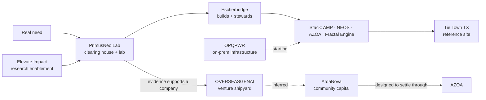

# Ecosystem map

Verified against each repo on 2026-11-08. Re-check the **Status** column before reusing any figure; every row names where its evidence lives.

## Entities

| Entity | Role | Source of truth | Status (2026-11-08) | Lead / steward |
|---|---|---|---|---|
| **PrimusNeo** | Federated coordination stack + the proposed Technology Innovation Lab (clearing house + lab) | this repo; Lab pack in `harrsoft/ElevateImpact/docs/primusneo-innovation-lab/` | Stack: Tie Town live. Lab: proposed, no revenue claimed | — |
| **AMP** | Operational runtime / Spatial OS | `docs/engagement-models/layers/amp.md` | Running at Tie Town [TX] | PLAN Systems |
| **NEOS** | Agreements & permissions | `docs/engagement-models/layers/neos.md` | Councils at Tie Town [TX] | OmniOne / Green Earth Vision |
| **AZOA** | Identity + consent, durable actions, settlement across chain and fiat | `C:\Users\atooz\Programming\Projects\oasis-sleek` (legacy folder name) | Pre-launch, Alpha Gate. 658 commits May–Oct 2026; ~4,800 automated tests written (static count); 39 of ~62 tracks shipped. Real-value bridges off by default | AZOA project (SurrealForge toolkit published by Escherbridge) |
| **Fractal Engine** | Intelligence & organizational memory | `docs/engagement-models/layers/fractal-engine.md` | Contributor memory at Tie Town [TX] | Escherbridge |
| **Elevate Impact** | Research enablement ("the fifth module") | `harrsoft/ElevateImpact` | Sickle cell flagship live in production. Links to the four layers **not built** | Ricardhy Grandoit, Sean Cain, Ahmed Zaher |
| **Escherbridge** | Engineering + governance studio; built this site and the EI platform | `Documents\Escherbridge\escherbridge-agency-site` | Services business | Ahmed Zaher (site: founder); Ahmad Darwish (principal) |
| **OVERSEASGENAI** | Agentic venture shipyard: idea → grilled → modelled → built → shipped → judged | `Documents\Escherbridge\overseasgenai` | Site, idea intake, founder accounts, private-preview launch live. Billing built but off | Ahmad Darwish |
| **ArdaNova** | Community-owned project platform: gated participation, task rewards, project tokens | `C:\Users\atooz\Programming\ArdaNova` | Scaffold. 1 of 10 sub-repos has code (3 commits); two early TEAL contracts; no deployment, users or offering | — |
| **Taawun** | Community app builder: escrowed quests, splits, donations, principal-only loans | referenced in AZOA `conductor/` | AZOA's second target consumer | — |
| **Tie Town [TX]** | Media and creator house, McDade, Texas | `src/app/solutions/community-coops/` | First active operational deployment; reference architecture | Rachel Schneider (owner-operator) |
| **Maplable** | Browser-based 3D globe for mapping and spatial collaboration; offline-ready, air-gappable; reads GeoJSON, KML/KMZ, CZML and ArcGIS feeds | [maplable.com](https://maplable.com/) | Spatial/GIS part of the stack, per the team; no written agreement found | Brandon Wallace (owner; 3D assets & GIS) |
| **Green Earth Vision** | 501(c)(3) nonprofit "to promote a society built on contribution, philanthropy, and self-organized models"; initiatives include OmniOne, Green Earth City, DHARMA-SARI | [greenearthvision.org](https://www.greenearthvision.org/our-team) | NEOS steward (with OmniOne), per `docs/engagement-models/00-overview.md`; its site does not mention NEOS | Josh Pasmore (founder) |
| **Nuva Labs** | Real-world-asset tokenization and management on Provenance Blockchain (formerly Provlabs) | [nuvalabs.com](https://www.nuvalabs.com/) | Affiliation of Max Gershfield; no company-level agreement found | Max Gershfield (listed by Nuva as Software Engineer) |
| **OPQPWR** (Opaque Power) | "Mission Infrastructure Platform": modular, field-deployable racks combining power, AI compute, storage, cooling and communications; "Solar In a Box" | [opqpwr.com](https://opqpwr.com/) | The stack's physical infrastructure layer, `L—00` (team decision, 2026-11-08), for a self-service, on-prem, bare-metal stack. Partnership starting; no deployment running | Contacts Dave and Denis (pending, see People) |
| **OMGEN** | Water-technology group; founder & chairman Jamie Nickell ("decades of experience in water technologies and microbiology"); brands include OMGEN Water, AgGen Global, EcoDigest Pro, Resonate Life Water | World Trumpet Television promo shared by Rachel Schneider, 2026-11-08 | Introduction route to OPQPWR ("via JP / OMGEN"). Not a stack partner. Its marketing makes wellness claims ("structured water for whole-body wellness"), so keep any mention to the introduction | Jamie Nickell |

## People

One team with no internal hierarchy (team decision, 2026-11-08). No one is more senior or holds more ownership than another, so the list is alphabetical. Keep it that way in every deck, page and document. Titles below are each person's title at their own organization, never a PrimusNeo rank.

| Person | Contribution | Layer | Own organization |
|---|---|---|---|
| Sean Cain | Operations design | Elevate Impact | Co-founder, Elevate Impact |
| Ahmad Darwish | Delivery & venture building | Ventures | OVERSEASGENAI; principal, Escherbridge |
| Max Gershfield | Blockchain governance & regulatory | NEOS · AZOA | Nuva Labs |
| Ricardhy Grandoit | People & programmes | Elevate Impact | Founder, Elevate Impact |
| Devin Johnson | Energy & AI infrastructure | Physical (OPQPWR) | Founder & CEO, Sol-Cap; CTO, Kaia Energia |
| Drew O'Meara | Spatial runtime | AMP | Creator, AMP SDK |
| Josh Pasmore | Governance architecture | NEOS | Founder, Green Earth Vision |
| Rachel Schneider | Site operations | Reference site | Owner-operator, Tie Town [TX] |
| Brandon Wallace | 3D assets & GIS | AMP | Owner, Maplable |
| Ahmed Zaher | Platform engineering | All layers | Founder, Escherbridge; Senior AI Engineer, Micron |

Advisors: the sickle cell advisory group of clinicians and advocates (Elevate Impact).

Identified: "Denis" is **Devin Johnson**, now on the roster. A résumé supplied by the team on 2026-11-08 lists an "OPQPWR Soil Remediation and Material Processing" project; confirm the name match with Rachel. Only professional details are used; the résumé itself stays out of the repo.

Pending: **Dave** of OMGEN, the team's other contact for OPQPWR, introduced via "JP / OMGEN" (Rachel Schneider, 2026-11-08). opqpwr.com and OMGEN's sites (omgenwater.com, aggenglobal.com, ecodigestpro.com, resonatelifewater.com) name neither, so surnames and roles must come from the team or OMGEN. "JP" is probably JP Nickell of OMGEN Water, Oklahoma City (LinkedIn search snippet, linkedin.com/in/jp-nickell; relationship to Jamie Nickell not stated anywhere); ask JP for Dave's surname and title, and add him to the roster alphabetically once confirmed.

## How the work moves

Solid edges are documented somewhere. The dotted edge is inference (see below).

## Documented relationships

- Escherbridge provides governance and engineering; OVERSEASGENAI runs the venture shipyard. The wording is identical on both sites.
- Escherbridge stewards Fractal Engine (`docs/engagement-models/00-overview.md`) and built this site and the Elevate Impact platform (Escherbridge portfolio).
- AZOA's first reference consumer is ArdaNova; the second is Taawun (`oasis-sleek/conductor/ARDANOVA-AZOA-INTEGRATION-CONTRACT.md`, decisions ratified 2026-09-07). ArdaNova's `conductor/tech-stack.md` names AZOA its financial engine. Rule: consumer concepts never enter AZOA primitives.
- AZOA depends on SurrealForge, published under the Escherbridge GitHub organization.
- Elevate Impact is described as the research module of the PrimusNeo stack (EI Vision deck). The Lab model allocates revenue between the Lab and EI as a management view, not a legal structure.

## Figures and where they come from

Every number on the site or in the deck must trace to one of these. Add a row before adding a figure.

| Figure | Source |
|---|---|
| Elevate Impact: 7 courses, 80 lessons, 3 languages; 1,185 trials analysed; 3,696 care and research centres mapped; 7,374 rare diseases catalogued; 390+ API operations; 121 data models; 6-stage lifecycle with 5 gates | `harrsoft/ElevateImpact/docs/Elevate-Impact-Vision.pdf` and `Elevate-Impact-Research-Platform.pdf` (platform data, Sept 2026) |
| Elevate Impact: "Minority Business Enterprise and Supplier Diversity Office certified" | `Elevate-Impact-Vision.pdf`. Keep the certificate on file before using it in sales material |
| Elevate Impact planned flow: AMP brings the field in → Fractal Engine measures → NEOS records the decision → AZOA settles the value | `Elevate-Impact-Vision.pdf`, stated there as future work. Always present as planned or "designed to" |
| OVERSEASGENAI: "Seven waves. Each one ends with an honest check."; 14-day scale / pivot / kill judgement | `overseasgenai/apps/site/index.html:89` (site heading); `Rebranded_To_OVERSEASGENAI.pdf` (Sept 2026 blueprint). The waves are the engagement their team runs with a founder, not a self-serve product (`overseasgenai/conductor/reviews/2026-10-03-synthesis.md`) |
| AZOA: 658 commits (May–Oct 2026); ~4,800 automated tests written; 39 of ~62 tracks shipped | static repository counts, `oasis-sleek`, 2026-11-08 |
| Financial model figures | `harrsoft/ElevateImpact/docs/PrimusNeo-Innovation-Lab-Financial-Model.html`, v2, 11 Sep 2026 |
| Market sizes, transactions, studio statistics | `.omc/research/deck-comps-2026-11-08.md` (confidence per row) |

## Inferred (do not state as fact)

- ArdaNova as the community-capital rail for ventures the Lab produces. Nothing in either repo says so, and the PrimusNeo `/fractionalization` page never names ArdaNova.
- AZOA as the settlement layer under Tie Town or Elevate Impact. The AZOA repo never mentions PrimusNeo, AMP, NEOS or Fractal Engine.
- Partnership economics (equity, revenue share, IP, exclusivity) between any two entities. None are documented.

## Claim limits for investor and public material

| Do not say | Say instead |
|---|---|
| AZOA is live, launched, audited, or "moves real money" | Pre-launch (Alpha Gate); identity and consent shipped and security-reviewed; real-value bridges off until production custody passes review |
| "1,500+ passing tests" (`src/app/azoa/`) or any pass rate | "~4,800 automated tests written" until a green build is confirmed after `platform-stub-closeout` |
| ArdaNova is live, has users, or ran an ICO / token offering | Pre-launch, compliance-gated; designed to settle through AZOA; Algorand TestNet route targeted |
| "ICO" anywhere | "Community-owned projects" / "asset-backed participation". The site already disavows ICO framing |
| Tokens carry equity, yield or redemption rights | Nothing. Any offering is subject to securities law and counsel |
| Novo Nordisk, Kamau Therapeutics or Sickleverse as customers or pilots | "Programme guides prepared for two life-sciences prospects; no contract claimed" |
| EI is integrated with AMP / NEOS / AZOA / Fractal Engine | Integration is in build |
| The $1.5M is committed, or the model's revenue is contracted | Proposed funding; planning assumptions |
| The stack runs on OPQPWR hardware, or an on-prem node is live | OPQPWR is the infrastructure partner for a self-service, on-prem, bare-metal path; partnership starting |
| "7,000+ communities" or the legacy layer name | Tie Town [TX]; AZOA |

## Open decisions before the next push

1. **Contribution labels.** The deck's roster gives each person a contribution label ("Operations design", "People & programmes", "Platform engineering" and so on). These were written from the source bios, not given by the people themselves; confirm each. PrimusNeo-internal titles such as CTO were removed so the team reads as peers. The $250,000 of founder capital stays on the proof slide without a name.
2. **AZOA authorship.** AZOA commits are authored as Jade Zaher. If that is Ahmed Zaher, add "principal author of AZOA" to the CTO bio.
3. **Use of funds.** The financial model has no use-of-funds split. The deck shows the model's year-one spending plan instead. Decide the split.
4. **Raise amount.** The model treats $1.5M as hypothetical; the EI Vision deck says "amount to confirm".
5. **Partnership terms** between PrimusNeo, Escherbridge, OVERSEASGENAI, Elevate Impact and ArdaNova.
6. **Site copy fixes in this repo.** Done 2026-11-08: the `/azoa` test claim, the "Art and Media Platform" name, "Builders Commons" as first pilot (one-pager and `/solutions` proof section) and the "ICO Refit" labels are fixed. Elevate Impact is now the stack's fifth component (`/elevate-impact`), and OVERSEASGENAI, Elevate Impact and OPQPWR are on the site as partners.
7. **ArdaNova framing.** `ArdaNova/documentation/ideation/ArdaNovaCoreConcept.md` and the Escherbridge portfolio entry still say "gamified ICO platform". Align with the compliance framing.
8. **Cross-repo docs.** If AZOA is meant to be a PrimusNeo layer, say so in `oasis-sleek/conductor/product.md`, and record the ArdaNova and Taawun relationships in PrimusNeo's `docs/engagement-models/layers/azoa.md`.
9. **Model calendar.** Month 1 is October 2026. Refresh the model if raise timing moves.
10. **Named partners.** Confirm spellings ("Schneider" is confirmed from Rachel's own messages, 2026-11-08; "O'Meara" is still unconfirmed) and get each person's consent before the deck is shared. Nuva Labs' site lists Max Gershfield as "Software Engineer"; the deck gives his PrimusNeo role and names Nuva only as an affiliation, so confirm that both he and Nuva are comfortable with that. Decide whether Maplable is a formal partner (the stack slide currently credits "maps · Maplable" under AMP).

## Investor deck

- Built file: [`docs/investor/primusneo-investor-deck.html`](../docs/investor/primusneo-investor-deck.html). It is self-contained; open it in a browser. Read mode is a scroll ebook. Present mode (button, or `P`) shows 1600×900 slides; navigate with the arrow keys, `Esc` to return.
- Source: `docs/investor/deck-src.html`. Rebuild with `python docs/investor/build_deck.py`, which inlines the emblems from `public/images/stack/`.
- Financial figures: `harrsoft/ElevateImpact/docs/PrimusNeo-Innovation-Lab-Financial-Model.html` (model v2, 11 Sep 2026), run with its own code for all three cases.
- External comparables and market sizes: `.omc/research/deck-comps-2026-11-08.md`, sourced with a confidence level per row.
